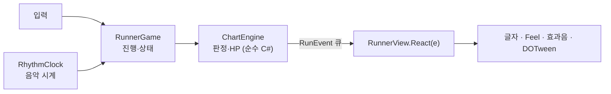
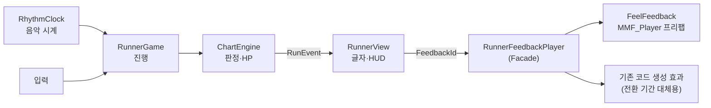

# AFTERECHO 작업 계획서: Feel 연출 개선과 팀 협업 규칙

> **상태:** 초안 (팀 리뷰 전) · **작성일:** 2026-10-17 · **작성:** (이름)
> **기준:** `feature/runner-circle` 브랜치 (`81ccd4c`)
> 이 문서는 제안입니다. **결정 필요(D번호)** 로 표시된 항목은 팀 합의 후 확정합니다.

---

## 0. 한눈에 보기

| 항목 | 내용 |
|---|---|
| 목표 | Feel을 "코드로 만드는 효과"에서 "인스펙터에서 조립하고 조정하는 효과"로 바꾸고, 판정·HP 로직과 분리된 **피드백 계층**을 만든다 |
| 방식 | 기존 동작을 깨지 않는 점진 전환 (Branch by Abstraction). 단계마다 Run Tests(173개), Play, 웹 빌드로 확인 |
| 순서 | 준비 → 피드백 계층 도입(화면 변화 없음) → 기존 효과 4개 프리팹 이전 → 새 효과 추가 → 튜닝·QA → 정리 |
| 핵심 원칙 | 음악 시계가 판정 기준이다 · 피드백은 결과만 표현한다 · 연출 수치는 코드가 아니라 에셋에 둔다 |

---

## 진행 상황 (2026-10-17)

브랜치 `feature/feel-feedback-layer` (로컬, 아직 push 안 함)

| 단계 | 상태 | 커밋 |
|---|---|---|
| 0. 준비 | 일부 완료. 작업 브랜치를 만들었고, 팀 합의(8장)와 로컬 설정 변경 정리가 남음 | — |
| 1. 피드백 계층 도입 | 완료 | `b5088b4` |
| 2. 기존 효과 프리팹 이전 | 완료 | `12ad2f6` |
| 3. 새 효과 추가 | 완료. PERFECT `193bfb5`, 판정 글자 `f206517`→1.4배 `d2dbb39`, HP바 `9ae34d3`, 질주 `6056cce`, 비틀거림 `ba70271`, 결과 창 `50673db`, 판정 UI·콤보·박자 링·HP 휘청임 `7d7a240` | 위 커밋들 |
| 4. 튜닝·QA | 대기 | — |
| 5. 정리 | 대기 (대체용 코드 `RunnerView.Feel()` 삭제 등) | — |

1·2단계 검증 결과 (바꾸기 전과 비교):

| 검사 | 결과 |
|---|---|
| Run Tests | 173/173 통과 (바꾸기 전과 같음) |
| 연출 회귀 검사 (`Tools/Runner/presentation_regressions.cs`) | 전부 통과 |
| 효과 최대 크기 | 판정 링 1.16, HP바 1.10, 질주 1.22, 떨어짐 0.80. 기존 값과 같음 |
| 움직임 줄이기 | 켜면 Feel 효과가 재생되지 않고 크기도 변하지 않음. 기존과 같음 |
| 콘솔 | 새 에러·경고 없음 |

### 프리팹 효과 튜닝 방법

> 효과별 위치·필드·현재 값은 [Feel 연출 조정 가이드](../feel-tuning-guide.md)에 정리하고 계속 갱신한다.

1. `Stage01_RunnerCircle` 씬에서 Play를 누른다.
2. Hierarchy에서 `Afterecho_RunnerCircle/Feedbacks/` 아래의 효과를 선택한다: `FB_Runner_Hit`, `FB_Runner_HitPerfect`, `FB_Runner_TargetPop`, `FB_Runner_DotPop`, `FB_Runner_JudgementText`, `FB_Runner_HpLoss`, `FB_Runner_HpWobble`, `FB_Runner_ComboPop`, `FB_Runner_ComboBreakWobble`, `FB_Runner_ComboBreakColor`, `FB_Runner_BeatPulse`, `FB_Runner_BoostStart`, `FB_Runner_BoostFlash`, `FB_Runner_Fall`, `FB_Runner_Stumble`, `FB_Runner_ResultPop`. HP바의 늦게 따라오는 바는 `RunnerCanvas/SafeArea/Health/HpBackground`의 `MMProgressBar`에서 조정한다(`DecreasingDelay`, `LerpDecreasingDelayedBarDuration`). 박자 링의 모양(지름·두께·색)은 `SafeArea/Judge/BeatPulse`의 `RunnerRing`에서 바꾼다.
3. 인스펙터의 MMF_Player에서 **Keep Playmode Changes**를 켜고 값을 조정한다. 각 피드백 오른쪽의 재생 버튼으로 바로 확인할 수 있다.
4. Play를 멈추면 값이 씬에 남는다. 확정할 값이면 인스펙터 상단의 **Overrides → Apply All**로 프리팹에 반영한다.
5. Keep Playmode Changes를 다시 끈다.

효과 대상(SquashAndStretchTarget)은 씬마다 다르므로 프리팹에 반영하지 않고 씬 쪽에 둔다. 씬을 새로 만들었거나 연결이 빠졌으면 메뉴 `Afterecho > Runner > Install Feedbacks In Open Scene`으로 다시 연결한다. 이 메뉴는 이미 있는 프리팹 값을 덮어쓰지 않는다.

## 1. 현재 상태 (2026-10-17 확인)

### 1.1 프로젝트 기본 정보

| 항목 | 값 |
|---|---|
| Unity | 6000.6.0f1 |
| 렌더링 | URP **2D Renderer** (`Assets/Settings/UniversalRP.asset` → `Renderer2D`) |
| 대상 플랫폼 | WebGL (PC, 모바일 가로) |
| 곡 | BPM 77.4 (한 박자 0.775초), 길이 136.36초 |
| 테스트 | `Afterecho > Runner > Run Tests` (2026-10-17 기준 173개 검사. README에는 138개로 적혀 있음) |
| 브랜치 | `feature/runner-circle`(개발)과 `main`이 서로 1커밋씩 갈라져 있음 |

러너 채보의 노트 간격(초)은 다음과 같습니다. 판정 피드백의 길이를 정하는 기준입니다.

| 난이도 | 노트 수 | 최소 간격 | 중앙값 |
|---|---|---|---|
| easy | 251 | 0.30 | 0.50 |
| normal | 281 | 0.22 | 0.42 |
| hard | 333 | **0.17** | 0.39 |

### 1.2 러너 모드 코드 흐름



### 1.3 Feel 사용 현황

- 러너 모드는 `MMF_Player` 4개(`HitFeel`, `HpFeel`, `BoostFeel`, `FallFeel`)를 씁니다. 각각 Squash & Stretch 효과 하나뿐이고, 모두 `RunnerView.Feel()`이 게임 시작 때 코드로 만듭니다.
- 이벤트별 현재 반응:

| 이벤트 (`RunEvent.kind`) | 의미 | 현재 반응 |
|---|---|---|
| `step` | 성공. 오차가 `min(35ms, 판정창×0.5)` 이하면 PERFECT | 글자 PERFECT/GOOD, `HitFeel`, 효과음 |
| `miss` | 놓침 | 글자 MISS, 넘어짐(`FallFeel` + 효과음), `HpFeel` |
| `extra` | 헛입력 | 글자 OFF BEAT, 비틀거림(DOTween), `HpFeel` |
| `won` | 클리어 | 클리어 효과음 |
| (상태) `Boosted` | 15콤보 질주 시작 | `BoostFeel`, 효과음, OVERDRIVE 글자. 이벤트가 아니라 매 프레임 상태를 비교해서 감지 |

- 이전 복도 모드(`AfterechoImpactFeedback` 등)도 같은 방식으로 Feel을 씁니다. 이번 작업 범위에는 넣지 않습니다.

### 1.4 문제점

1. **모든 효과를 코드로 만듭니다.** 인스펙터에서 조정하거나 Play 중에 튜닝할 수 없고, 크기·시간 같은 값이 코드에 숫자로 박혀 있습니다.
2. **`RunnerView` 한 파일에 책임이 몰려 있습니다.** UI, 캐릭터, Feel, 효과음, DOTween이 섞여 있습니다. 팀 아키텍처 문서 9장과 같은 진단입니다.
3. **이벤트 종류가 문자열(`"step"`)입니다.** 오타가 나도 컴파일러가 잡지 못합니다. 팀 문서 10장 5번 항목과 같은 문제입니다.
4. **Feel 데모 대부분이 3D 렌더러 기준입니다.** 이 프로젝트(2D Renderer)에서는 화면이 깨지므로 2D·UI 데모만 참고합니다. 목록은 부록 C에 있습니다.
5. **Feel 기능 중 2D와 웹에 맞는 것만 쓸 수 있습니다.** 셰이더 기반 효과와 진동은 쓸 수 없습니다.

---

## 2. 목표와 범위

**작업 대상 씬:** `Assets/Afterecho/Scenes/Stage01_RunnerCircle.unity`만 다룹니다. `Stage01_BlackCorridor.unity`(이전 복도 버전)는 사용하지 않고 수정하지 않습니다.

**이번에 하는 것**
- 러너 모드 피드백을 프리팹 기반 `MMF_Player`로 전환
- 피드백 계층(`RunnerFeedbackPlayer`) 도입
- 새 연출 추가: 판정 글자, HP바, 질주 시작, 클리어
- 움직임 줄이기 설정 지원
- 웹 성능 확인

**이번에 하지 않는 것**
- 이전 복도 모드 수정
- 판정·점수·HP 규칙 변경
- 폴더 구조 대개편 (D7)
- 패키지 추가 (D6)
- 새 아트 리소스 제작

**완료 기준**
1. 러너의 모든 피드백을 인스펙터에서 조정할 수 있다.
2. 판정·HP·점수 결과가 기존과 같다. Run Tests 173개가 통과한다.
3. 움직임 줄이기를 켜면 움직임·번쩍임 효과가 꺼지고, 소리·글자는 유지된다.
4. 웹 빌드(PC Chrome, 모바일 가로)에서 프레임 저하나 GC 스파이크가 없다.
5. 모든 변경이 PR 리뷰를 통과했다.

---

## 3. 아키텍처

### 3.1 지켜야 할 원칙

팀 아키텍처 문서의 원칙 1~5에 이 작업에 필요한 원칙 6~7을 더했습니다.

1. **음악 시각이 판정 기준이다.** 화면 프레임이나 연출이 판정 시계를 대신하지 않는다.
2. **상태 계산과 연출을 구분한다.** 이펙트를 실행하거나 취소해도 HP·성공 여부가 바뀌지 않는다.
3. **규칙의 기준값은 하나로 둔다.**
4. **진행 제어가 이벤트를 소비한다.** 지금의 큐 방식을 유지한다.
5. **공통부는 이전 화면에 의존하지 않는다.**
6. **피드백 계층은 한 방향으로만 흐른다.** 판정 → 이벤트 → 화면 → 피드백 순서이고, 피드백은 게임 상태를 읽을 수는 있어도 바꾸지 않는다.
7. **연출 수치는 코드가 아니라 프리팹이나 ScriptableObject에 둔다.**

### 3.2 목표 구조



### 3.3 적용할 디자인 패턴

| 패턴 | 어디에 | 이유 |
|---|---|---|
| **Observer** (이벤트 큐) | `ChartEngine` → `RunEvent` (기존 유지) | 판정 로직이 연출을 몰라도 된다 |
| **Facade** | `RunnerFeedbackPlayer` | 화면 코드는 "무엇을" 재생할지만 요청하고, Feel·효과음·DOTween 세부는 숨긴다 |
| **Adapter** | `IFeedback` ← `MMF_Player` | Feel을 교체하거나, 테스트에서 가짜 객체로 바꿀 수 있다 |
| **Null Object** | 등록되지 않은 ID는 아무것도 하지 않는다 (`Play`가 `false` 반환) | 연결이 비어 있어도 호출하는 쪽에 null 검사나 분기가 필요 없다 |
| **Branch by Abstraction** (리팩터링 전략) | 기존 코드 생성 효과를 대체용으로 두고 하나씩 프리팹으로 교체 | 항상 동작하는 상태로 조금씩 옮길 수 있다 |
| **데이터 주도** (Prefab, ScriptableObject) | 강도·시간·색 | 코드 수정 없이 기획·튜닝할 수 있다 |
| **Prefab Variant** | GOOD/PERFECT처럼 강도만 다른 효과 | 공통 부분을 한 번에 고칠 수 있다 |
| **Object Pool** | 판정 글자·파티클처럼 자주 생기는 것 | 플레이 중 생성(Instantiate)과 GC를 막는다. Feel의 `MMSimpleObjectPooler`를 쓸 수 있다 |

**피할 것**
- 싱글턴 남발
- 런타임 `FindObjectOfType` 검색
- 문자열 이벤트 비교를 여기저기 늘리기
- 피드백 안에서 HP·점수 바꾸기
- `Update`에서 매 프레임 `new` 할당
- `Time.timeScale` 변경

### 3.4 구현 (1단계 완료)

`Assets/Afterecho/Runtime/Feedback/` (네임스페이스 `Afterecho.Feedback`)

| 파일 | 역할 |
|---|---|
| `FeedbackId.cs` | `FeedbackId`(무엇을 보여 줄지)와 `FeedbackChannel`(움직임 줄이기 필터용 분류). 값은 씬에 저장되므로 새 ID는 끝에만 추가하고 번호를 바꾸지 않는다 |
| `IFeedback.cs` | `Play()` / `Stop()` 인터페이스. 구현체는 점수·HP·판정을 바꾸면 안 된다 |
| `FeelFeedback.cs` | `MMF_Player`를 `IFeedback`으로 감싼다(Adapter). 매번 처음부터 다시 재생한다 |
| `RunnerFeedbackPlayer.cs` | 피드백 재생의 단일 창구(Facade). 인스펙터의 `bindings`(ID → 채널 → `MMF_Player`)를 먼저 쓰고, 없으면 코드에서 등록한 대체용 효과를 쓴다 |

현재 `FeedbackId`는 `HitGood`, `HitPerfect`, `HpLoss`, `Fall`, `BoostStart` 다섯 개입니다. `HitGood`과 `HitPerfect`는 지금 같은 효과를 씁니다. 3단계에서 PERFECT 강조를 따로 주기 위한 자리입니다.

한 ID에 여러 효과를 묶을 수 있습니다(예: `HpLoss` = 튀는 효과 + 흔들림, `BoostStart` = 캐릭터 확대 + 화면 번쩍임). 효과마다 채널이 따로 있어서 움직임 줄이기 필터도 따로 적용됩니다. 프리팹 하나에는 효과 하나와 대상 하나만 둡니다.

`FeedbackChannel`은 한 가지 값만 가집니다(`Motion`, `Flash`, `Audio`, `Text`). 움직임 줄이기를 켜면 `Motion`·`Flash`가 꺼집니다. 그래서 `MMF_Player` 하나에는 한 채널의 효과만 담습니다.

`RunnerView`는 효과를 직접 만들거나 부르지 않고 ID로 요청합니다.

```csharp
// RunnerView.React()
Play(perfect?FeedbackId.HitPerfect:FeedbackId.HitGood);

// RunnerView.Play(): 움직임 줄이기 여부를 넘기고, 실제로 재생됐을 때만 횟수를 센다
void Play(FeedbackId id)
{feedback.ReducedMotion=game.reducedMotion;if(feedback.Play(id))FeedbackPlays++;}
```

- 씬에 `RunnerFeedbackPlayer`가 없으면 `RunnerView`가 실행 중에 붙입니다. 연결되지 않은 ID는 기존 `Feel()`로 만든 효과를 대체용으로 등록합니다.
- **효과음은 2단계까지 기존 `Sound()` 경로를 그대로 둡니다.** 판정 효과음은 지연에 민감하기 때문입니다. Feel의 `MMF_Sound`로 옮길지는 3단계에서 지연을 측정한 뒤 정합니다.
- **문자열 `kind`를 enum으로 바꾸는 작업은 이번 범위가 아닙니다.** 팀 문서 10장 5번 항목에서 따로 진행합니다. 여기서는 변환 지점을 `React()` 한 곳으로 모으기만 합니다.

### 3.5 Feel 관련 폴더와 이름 규칙

| 대상 | 규칙 |
|---|---|
| 스크립트 위치 | `Assets/Afterecho/Runtime/Feedback/`, 네임스페이스 `Afterecho.Feedback` |
| 프리팹 위치 | `Assets/Afterecho/Runner/Feedbacks/` (폴더 개편 때 함께 이동, D7) |
| 프리팹 이름 | `FB_<모드>_<이벤트>`. 예: `FB_Runner_HitPerfect`. 강도만 다르면 `FB_Runner_Hit_Base`의 Variant로 만든다 |
| Feel 원본 | `Assets/Feel/` 파일은 수정하지 않는다. 데모 씬은 저장하지 않는다 |
| 데모 에셋 | 게임에서 데모 에셋을 직접 참조하지 않는다. 데모를 지우면 깨지므로, 필요한 것은 우리 폴더로 복사해서 쓴다 |

---

## 4. Feel 사용 규칙 (리듬게임·2D·웹 기준)

| # | 규칙 | 이유 |
|---|---|---|
| 1 | 모든 피드백의 Timing을 **Unscaled**로 둔다. `Time.timeScale`을 바꾸는 피드백(`MMF_FreezeFrame`, `MMF_TimescaleModifier`)은 쓰지 않는다 | 화면을 멈춰도 음악은 멈추지 않아서 화면과 박자가 어긋난다 |
| 2 | 판정 피드백은 **0.15초 이하**로 하거나, 겹쳐 재생돼도 깨지지 않게 만든다 | hard 난이도의 최소 노트 간격이 0.17초다 |
| 3 | 판정 피드백에 **시작 지연(Initial Delay)** 을 넣지 않는다 | 입력과 반응 사이 지연으로 느껴진다 |
| 4 | 같은 효과를 연속 재생할 때는 **처음부터 다시** 재생한다 (Stop → Restore → Play) | 이전 효과 도중의 값에서 시작하면 크기가 누적된다 |
| 5 | 화면 전체가 번쩍이는 효과는 **초당 3회 미만**으로 제한한다 | 광과민성 발작을 막기 위한 접근성 기준(WCAG 2.3.1)이다. hard에서는 노트가 초당 최대 약 6개라서, 매 판정마다 번쩍이면 기준을 넘는다 |
| 6 | 움직임 줄이기가 켜지면 Motion·Flash 채널을 끄고 Audio·Text 채널은 유지한다. `MMF_Player` 하나에는 한 채널의 효과만 담는다 | 기존 `reducedMotion` 동작과 같다. 섞어 담으면 소리까지 같이 꺼진다 |
| 7 | **2D Renderer에서 동작하는 피드백만** 쓴다 | 2D 렌더러에서는 3D용 패스가 그려지지 않는다 |
| 8 | 피드백은 결과만 보여 준다. HP·점수·판정을 바꾸지 않는다 | 원칙 2 |
| 9 | 전환이 끝나면 런타임에 `MMF_Player`를 코드로 만들지 않는다 | 인스펙터에서 튜닝할 수 있어야 한다 |
| 10 | Play 중 튜닝에는 **Keep Playmode Changes**를 쓰고, 끝나면 체크를 해제한다 | 켜 둔 채로 두면 실수로 바꾼 값까지 저장된다 |
| 11 | 박자에 맞춘 연출(맥동 등)은 **`RhythmClock` 시간**으로 구동한다. `MMAudioAnalyzer`·`MMSequencer`의 자체 타이머는 쓰지 않는다 | 판정 시계와 어긋나지 않게 하기 위해서다 |

규칙 7에 따라 쓸 수 있는 피드백과 피할 피드백:
- **사용:** 크기·위치·회전, Squash & Stretch, SpriteRenderer, UI(Image, CanvasGroup, TextMeshPro), 사운드, 카메라 흔들림(`MMF_CameraShake`), UI 번쩍임(`MMF_Flash`), HP바(`MMProgressBar`)
- **피함:** 셰이더 기반 효과(MMAdvancedToon, 외곽선, 발광 깜빡임), 3D 조명, 진동(NiceVibrations는 웹에서 동작하지 않음)
- **확인 후 사용:** URP 후처리(Volume) 효과는 모바일 웹 성능을 확인한 뒤에만 쓴다.

---

## 5. 작업 단계

예상 기간은 1인 기준 대략치이며, 리뷰 일정에 따라 조정합니다.

### 0단계: 준비 (0.5일)
- 이 문서를 팀이 리뷰하고, 8장의 결정 사항에 합의한다.
- 작업 브랜치를 만든다: `feature/feel-feedback-layer` (기준 브랜치는 D2에 따름)
- 로컬 변경을 정리한다. Unity가 열면서 바꾼 설정 파일과, 로컬에서만 추가된 패키지 3개(Cinemachine, Post Processing, Recorder)는 커밋하지 않고 되돌린다.
- **완료 조건:** 합의 내용이 기록되어 있고, 작업 폴더에 남은 변경이 없다.

### 1단계: 피드백 계층 도입, 화면 변화 없음 (완료)
- `IFeedback`, `FeelFeedback`, `FeedbackId`, `RunnerFeedbackPlayer`를 추가한다.
- `RunnerView`에서 기존 `Feel()`로 만든 4개를 `RegisterFallback`으로 등록하고, `React()`와 질주 감지 부분을 `feedback.Play(id)` 호출로 바꾼다. 재시작 경로에서는 `StopAll()`을 부른다.
- `RunnerSceneBuilder`에도 `RunnerFeedbackPlayer` 컴포넌트를 추가해서, 씬을 다시 생성해도 유지되게 한다.
- **완료 조건:** Run Tests 173개 통과. 바꾸기 전후 Play 녹화를 비교해 차이가 없다. PR이 승인됐다.

### 2단계: 기존 효과 4개를 프리팹으로 이전 (완료)
- `Assets/Afterecho/Runner/Feedbacks/`에 `FB_Runner_Hit`, `FB_Runner_HpLoss`, `FB_Runner_BoostStart`, `FB_Runner_Fall` 프리팹을 만들었다. 수치는 기존 값 그대로다(부록 D).
- 효과 대상이 씬 오브젝트라서, 프리팹 인스턴스를 씬의 `Afterecho_RunnerCircle/Feedbacks` 아래에 두고 대상은 씬 쪽 값으로 연결했다.
- `RunnerFeedbackInstaller`가 프리팹 생성(없을 때만), 씬 배치, 바인딩 연결을 맡는다. `RunnerSceneBuilder.Build()`도 이 도구를 호출하므로, 씬을 다시 생성해도 연결이 유지된다. 다만 씬 전체를 다시 생성하는 `Build()`는 이번에 실행하지 않았다.
- 씬 변경은 줄 추가만 있고 기존 줄은 바뀌지 않았다.
- **완료 조건 충족:** 수치 동일, 테스트 통과, 대체용 코드 효과가 더 이상 만들어지지 않음.

### 3단계: 새 효과 추가 (2~4일, 항목마다 PR 1개)

| 우선 | 이벤트 | 제안 효과 | 참고 데모 | 주의 |
|---|---|---|---|---|
| 1 ✅ | `step` (PERFECT) | **완료:** `FB_Runner_HitPerfect`(`FB_Runner_Hit`의 Prefab Variant, 최대 배율 1.16 → 1.25) | Letters | 0.15초 이하, 번쩍임 없음 |
| 1-2 ✅ | `step` / `miss` / `extra` / OVERDRIVE | **완료:** 판정 글자 튀어나옴. `FB_Runner_JudgementText`(`MMF_Scale`, 1.4배, 0.12초) | Letters | Motion 채널이라 움직임 줄이기 때 꺼짐 |
| 2 ✅ | `miss` / `extra` | **완료:** HP바 뒤에 늦게 따라 줄어드는 바(`HpDelayed`)를 넣고 Feel의 `MMProgressBar`가 구동(0.2초 대기 후 0.3초). HP가 줄면 게이지가 휘청임(`FB_Runner_HpWobble`, `MMF_Rotation`, 7도, 0.35초). 처음 넣은 좌우 위치 흔들림은 거의 보이지 않아 회전으로 교체. 튀는 효과는 기존 `FB_Runner_HpLoss` | MMProgressBar | 성공(+1 HP)이 오면 따라오던 바가 바로 맞춰짐(Feel 동작). 움직임 줄이기 때는 즉시 갱신, 휘청임 없음. 연습 모드에서는 HP가 줄지 않아 보이지 않음 |
| 3 ✅ | 질주 시작 | **완료:** 화면 번쩍임 1회(`FB_Runner_BoostFlash`, `MMF_ImageAlpha`, 투명도 0.45, 0.3초, Flash 채널)와 OVERDRIVE 글자 튀어나옴. 카메라 흔들림은 쓰지 않음: 화면 전체가 카메라에 붙은 Canvas라서 카메라를 흔들어도 화면이 같이 움직임. 가장자리 강조는 새 아트가 필요해 보류 | Snake | 번쩍임은 15콤보마다 최대 1회라 초당 3회 기준보다 훨씬 적다 |
| 4 ✅ | `extra` | **완료:** 비틀거림을 DOTween에서 Feel로 이전(`FB_Runner_Stumble`, `MMF_Rotation`, −9도, 0.12초). `RunnerView`는 더 이상 DOTween을 쓰지 않음. `presentation_regressions.cs`의 12개 검사를 Feel 기준으로 바꿈(의도는 같음) | — | 기존 느낌 유지 |
| 5 ✅ | 결과 화면 (클리어·실패) | **완료:** 결과 창이 0.85배에서 1.015배까지 살짝 넘쳤다가 1배로 자리 잡음(`FB_Runner_ResultPop`, `MMF_Scale`, 0.3초) | CardsUI, ParallaxUI | 움직임 줄이기 때는 바로 1배 |
| 6 ✅ | 박자 | **완료:** 판정 UI 바깥에 박자 링(`BeatPulse`, 지름 300)을 두고 박자마다 1.12배로 숨 쉬듯 맥동(`FB_Runner_BeatPulse`, 0.45초). `stage.json`의 `beats`와 `LogicalTime`(판정과 같은 음악 시계, 싱크 보정 포함)으로 박자를 찾고, 준비 카운트에서도 맥동 | Brass (참고만) | 오디오 분석(`MMAudioAnalyzer`)은 웹 빌드에서 스펙트럼 데이터를 쓸 수 없어 사용하지 않음 |
| 7 ✅ | `step` | **완료:** 성공할 때마다 고정 링(1.12배)과 가운데 점(1.6배)이 튐(`FB_Runner_TargetPop`, `FB_Runner_DotPop`) | — | 박자 링과 다른 오브젝트라 서로 간섭하지 않음 |
| 8 ✅ | 콤보 | **완료:** 콤보가 오르면 글자가 튐(1.25배, `FB_Runner_ComboPop`). 끊기면 휘청이고(10도) 빨갛게 번쩍임(`FB_Runner_ComboBreakWobble`, `FB_Runner_ComboBreakColor`/`MMF_TMPColor`) | — | 색은 정보라 Text 채널: 움직임 줄이기 때도 유지 |

- 1번 메모: GOOD과 PERFECT 효과가 같은 대상(`HitResponse` 링)을 쓴다. 효과 길이(0.115초)가 노트 최소 간격(0.17초)보다 짧아서 두 효과가 겹치지 않는다. 길이를 늘릴 때는 이 조건을 다시 확인한다.
- 1번 검증: GOOD 1.16배, PERFECT 1.25배로 재생되고 둘 다 원래 크기로 돌아옴. Run Tests 173/173, 연출 회귀 검사 통과, 새 콘솔 에러·경고 없음.
- 판정 글자 검증: 1.2배까지 커졌다 원래대로. 움직임 줄이기 때는 글자만 바뀌고 크기는 그대로. 이 연출이 추가되면서 `FeedbackPlays`가 판정마다 1씩 더 늘어난다. 이 값을 쓰는 테스트는 없다.
- HP바 검증: HP −10이면 HP바는 즉시 0.90, 늦게 따라오는 바는 0.1초 시점에 1.00 → 0.7초 시점에 0.90. 움직임 줄이기 때는 둘 다 즉시. 메뉴로 돌아가면 둘 다 1.00. Run Tests 173/173, 연출 회귀 검사 통과, 기존 효과 크기 변화 없음, 새 콘솔 에러·경고 없음.
- HP바 메모: 늦게 따라오는 바의 위치·크기·스프라이트는 실행 시 `HpFill`에서 복사한다. UI 스타일 스크립트가 `HpFill`을 바꿔도 맞춰진다.
- 3·4·5번 검증: Run Tests 173/173, 연출 회귀 검사 10/10. 측정값: 번쩍임 0.45 → 0, 결과 창 0.85 → 1.015 → 1.000, 비틀거림 좌우로 흔들린 뒤 0도로 복귀(DOTween 트윈 0개). 움직임 줄이기 때는 모두 동작하지 않음. 새 콘솔 에러·경고 없음.
- 연출 회귀 검사 변경 메모: "첫 비틀거림 도중 두 번째 헛입력" 확인은 0.05초 뒤 상태를 본다. 비틀거림 곡선이 이 시점 근처에서 0도를 지나므로 각도는 확인하지 않는다. 에디터 프레임이 길어져 0.12초 효과가 먼저 끝나면 최대 3번 다시 시도한다. 다시 시작한 순간 각도가 0인지는 그대로 확인한다.
- 6·7·8번과 HP 휘청임 검증: HP 휘청임 −4.7~7도 후 0도. 고정 링 1.12배, 가운데 점 1.6배. 콤보 1.25배. 콤보 끊김 ±10도와 빨간색, 원래 색으로 복귀. 박자 링은 준비 카운트 4번과 연주 중 8번 맥동했고 측정상 박자보다 0.02~0.04초 늦게 보임(대부분 측정 방식의 지연). 움직임 줄이기 때는 빨간색만 남음. Run Tests 173/173, 연출 회귀 검사 5/5, 새 콘솔 에러·경고 없음.
- 모든 PR에는 변경 전후 GIF나 영상을 첨부한다.

### 4단계: 튜닝·QA (1~2일)
- [ ] 세 난이도 완주
- [ ] 움직임 줄이기 켜고 끄기
- [ ] 일시정지·재시작·메뉴 복귀 때 효과 잔상이 남지 않음
- [ ] 싱크 보정(`syncMs`)을 바꿔도 피드백 타이밍이 정상
- [ ] 웹 빌드에서 확인: PC Chrome, 모바일 가로. 게임 중 프레임당 GC 할당이 0인지 Profiler로 확인
- [ ] 플레이테스트 의견 수집

### 5단계: 정리 (0.5일)
- 대체용 코드(`RunnerView.Feel()`)를 삭제한다.
- 팀 아키텍처 문서에 반영하고 이 문서를 갱신한다.

---

## 6. 협업 규칙 (현업 기준 제안)

### 6.1 브랜치 전략: GitHub Flow 기반

- **`main`** 은 항상 실행 가능한 상태로 둔다. 직접 push는 막고(브랜치 보호), PR로만 병합한다.
- **작업 브랜치 이름**은 `<종류>/<범위>-<요약>` 형식으로 짓는다. 예: `feature/feel-feedback-layer`, `fix/runner-hp-bar`, `docs/feel-plan`
- **브랜치는 짧게 유지한다.** 2~3일 안에 PR을 올리고, 오래 걸리면 기준 브랜치를 자주 병합한다.
- 지금은 `feature/runner-circle`이 사실상 통합 브랜치 역할을 하고 있다 (D2).

### 6.2 커밋

- [Conventional Commits](https://www.conventionalcommits.org/ko/v1.0.0/) 형식을 쓴다: `feat(feedback): 피드백 계층 추가`, `fix(runner): …`, `refactor`, `docs`, `chore`, `test`
- 제목은 50자 안팎으로 쓰고 한국어도 괜찮다. 본문에는 "왜" 바꿨는지 적는다.
- 커밋 하나에는 의도 하나만 담는다. 코드, 씬·프리팹, 설정 변경은 가능하면 커밋을 나눈다.
- 각자 Git 사용자 이름을 설정한다. 현재 커밋 작성자가 `aaa`로 기록되어 있다.

```bash
git config --global user.name "이름"
```

### 6.3 PR

- 템플릿(부록 A)을 쓴다. 리뷰어 1명 이상의 승인을 받고, 본인 PR을 직접 병합하지 않는다 (D10).
- 코드는 PR당 400줄 이하를 권장한다. 연출을 바꾼 PR에는 GIF나 영상이 필수다.
- 병합은 **Squash merge**를 권장한다.
- 리뷰는 체크리스트(부록 B)를 기준으로 한다.

### 6.4 Unity 협업 규칙

1. **에디터 버전은 6000.6.0f1로 고정한다.** 다른 버전으로 열지 않는다.
2. **`.meta` 파일은 항상 에셋과 함께 커밋한다.** 파일 이동과 이름 변경은 Unity의 Project 창에서만 한다.
3. **커밋하지 않는 것:** `Library/`, `Temp/`, `Logs/`, `UserSettings/`, `*.csproj`, `*.sln` (대부분 이미 `.gitignore`에 있음)
4. **Unity가 열면서 자동으로 바꾼 설정 파일**은 의도한 변경이 아니면 커밋하지 않는다.
5. **패키지(`Packages/manifest.json`)와 `ProjectSettings` 변경**은 미리 합의하고 별도 PR로 올린다.
6. **같은 씬을 두 사람이 동시에 수정하지 않는다.** 작업 전에 채널에 알린다. 변경은 가능한 프리팹 단위로 하고, 씬에는 프리팹을 배치만 한다.
7. **러너 씬은 `RunnerSceneBuilder`가 생성한다.** 씬을 손으로 고쳐도 생성기를 다시 돌리면 덮어써질 수 있다. 씬을 어떻게 관리할지 정해야 한다 (D4).
8. **Smart Merge(UnityYAMLMerge) 설정을 권장한다.** 씬·프리팹 충돌을 자동으로 풀어 준다.
9. **Domain Reload가 꺼져 있다.** static 필드는 `[RuntimeInitializeOnLoadMethod(RuntimeInitializeLoadType.SubsystemRegistration)]`에서 초기화한다. 그러지 않으면 Play를 다시 눌러도 값이 남는다.
10. **유료 에셋(Feel, DOTween Pro)** 은 비공개 저장소에서만 다룬다. 원본 파일을 외부에 공유하지 않는다 (D1, D8).

### 6.5 코드 스타일 (D5)

새 코드부터 적용하고, 기존 코드는 손댈 때 조금씩 정리한다(보이스카우트 규칙).

- 이름은 Microsoft C# 규칙과 기존 코드 관례를 따른다. 타입·메서드·프로퍼티는 PascalCase, 지역 변수·매개변수·private 필드는 camelCase로 쓴다 (기존 코드처럼 밑줄 없이).
- 한 줄에는 문장 하나만 쓰고, 블록은 줄을 바꿔 쓴다. 기존 코드의 압축된 한 줄 스타일은 새 코드에서 쓰지 않는다.
- 매직 넘버를 쓰지 않는다. 상수, ScriptableObject, 프리팹 값으로 뺀다.
- public 필드 대신 `[SerializeField] private`를 쓴다.
- 네임스페이스는 `Afterecho.*`를 쓴다.
- 자주 실행되는 코드(`Update`, `React`)에서 할당하지 않는다. LINQ, 람다 캡처, 새 배열 생성이 여기에 해당한다.
- 주석에는 "무엇"보다 "왜"를 적는다.
- `.editorconfig`를 도입해서 포맷을 자동으로 맞춘다.

### 6.6 소통과 작업 관리

- 작업 단위는 **이슈 1개 = 브랜치 1개 = PR 1개**로 맞춘다. 이슈는 GitHub Issues나 Notion 보드에서 관리한다.
- 이슈에는 배경, 목표, 완료 조건, 참고 자료를 적는다.
- 상태는 `할 일 → 진행 중 → 리뷰 → 완료` 순서로 옮긴다.
- 매일 세 줄로 공유한다: 어제 한 일, 오늘 할 일, 막힌 점.
- **완료 정의(DoD):** 테스트 통과, Play 확인, 리뷰 승인, 문서 갱신, 웹 빌드 영향 확인

---

## 7. 도구와 AI 사용 규칙

| 도구 | 용도 |
|---|---|
| Unity CLI (1.0.0-beta.13) | 에디터 상태 확인, 명령 실행, 테스트, 빌드 |
| `unity` MCP (CLI 내장) | Claude 같은 AI가 열린 에디터를 조작한다 (씬, 컴포넌트, Play, 캡처, 테스트) |
| `unity-mcp` (Unity AI Assistant) | 프로파일러 분석 등 보조 용도 |
| GitHub Desktop / Git | 브랜치, 커밋, PR |

- Pipeline 패키지(`com.unity.pipeline` 0.7.0-exp.1) 버전을 바꾸려면 팀 합의가 필요하다 (D9). CLI는 각자 최신 베타를 쓴다.
- AI가 만든 변경도 똑같이 PR 리뷰를 거친다.
- AI는 씬을 저장하거나 커밋하지 않는다. 사람이 확인한 뒤에 한다.
- 커밋 메시지에 AI 공동 작성을 표기할지 정한다.

---

## 8. 팀 결정이 필요한 사항

| ID | 결정할 것 | 제안 | 이유 |
|---|---|---|---|
| D1 | 저장소 공개 여부 | **비공개로 전환** | README는 비공개를 전제로 하는데, 2026-10-17 현재 Public이고 유료 에셋이 들어 있다 |
| D2 | 통합 브랜치 | `feature/runner-circle`을 `main`에 병합한 뒤 `main` 기준으로 작업 | 지금 두 브랜치가 갈라져 있다 (main에만 문서, feature에만 최신 기능) |
| D3 | Git LFS | 지금 도입하거나 보류 | 커밋이 6개뿐이라 지금이 가장 싸다 |
| D4 | 러너 씬 관리 방식 | 생성기로 관리할지, 손으로 관리할지 | 생성기를 다시 돌리면 수동 변경이 덮어써질 수 있다 |
| D5 | 코드 스타일 | 6.5절 채택 여부, `.editorconfig` 도입 | 기존 코드와 스타일이 다르다 |
| D6 | 패키지 추가 | Cinemachine, Post Processing, Recorder는 추가하지 않음 | 2D 렌더러에는 Post Processing(v2)이 필요 없다. 지금은 로컬에만 있다 |
| D7 | 폴더 구조 개편 시기 | Feel 작업이 끝난 뒤 별도 PR | 작업 중 폴더를 옮기면 충돌이 커진다 |
| D8 | Feel 라이선스 | 팀원별 좌석 라이선스가 필요한지 확인 | 에디터 확장 에셋은 보통 사용자마다 라이선스가 필요하다 |
| D9 | Pipeline 패키지 0.8.0 업그레이드 | 보류 | 실험(exp) 패키지라 변화가 크다 |
| D10 | PR 승인 규칙 | 1명 승인, Squash merge | 6.3절 |
| D11 | 전역 빌드 설정의 씬 | 전역 Build Settings를 `Stage01_RunnerCircle`로 바꾸거나 복도 씬을 빼기 | 지금 전역 설정에는 쓰지 않는 `Stage01_BlackCorridor`만 켜져 있다. 러너 빌드 프로필이 씬 목록을 덮어써서 프로필로 빌드하면 문제없지만, 기본 설정으로 빌드하면 복도 씬이 빌드된다 |

---

## 9. 리스크

| 리스크 | 대응 |
|---|---|
| 판정과 연출 타이밍이 어긋남 | 4장 규칙 1~3, 11을 지키고 `syncMs`를 바꿔 가며 테스트한다 |
| 웹·모바일 성능 저하 | Profiler로 확인하고, 후처리 효과는 확인 후에만 쓴다 |
| 씬 생성기가 수동 변경을 덮어씀 | D4로 관리 방식을 정한다 |
| `RunnerView.cs` 충돌 (다른 사람도 수정) | 작업 전에 알리고, PR을 작게 유지한다 |
| 실험·프리릴리스 패키지가 바뀜 (Pipeline, AI Assistant) | 버전을 고정한다 (D9) |

---

## 10. 참고

- 팀 아키텍처 문서: `docs/architecture/afterecho-architecture.md` (`main` 브랜치)
- Feel 공식 문서: https://feel-docs.moremountains.com/
- Unity CLI 소개: https://unity.com/kr/blog/meet-the-unity-cli
- Conventional Commits: https://www.conventionalcommits.org/ko/v1.0.0/
- WCAG 2.3.1 (번쩍임 기준): https://www.w3.org/WAI/WCAG21/Understanding/three-flashes-or-below-threshold.html

---

## 부록 A. PR 템플릿

```markdown
## 무엇을
- (변경 요약)

## 왜
- (이슈 링크, 배경)

## 어떻게 확인했나
- [ ] Run Tests 173개 통과
- [ ] Stage01_RunnerCircle Play (easy / normal / hard)
- [ ] 움직임 줄이기 켜고 끄기
- [ ] 웹 빌드 영향 (해당 시)

## 화면
- (변경 전후 GIF 또는 영상)

## 리뷰어에게
- (특히 봐 줬으면 하는 부분)
```

## 부록 B. 코드 리뷰 체크리스트

- [ ] 피드백이 HP·점수·판정을 바꾸지 않는다
- [ ] 피드백 Timing이 Unscaled이고, `timeScale`을 바꾸지 않는다
- [ ] 판정 피드백이 0.15초 이하이거나 겹쳐도 깨지지 않는다
- [ ] 움직임 줄이기 설정을 따른다 (채널이 올바르게 지정됨)
- [ ] 화면 전체 번쩍임이 초당 3회 미만이다
- [ ] 수치가 코드가 아니라 프리팹이나 ScriptableObject에 있다
- [ ] 자주 실행되는 코드에서 할당하지 않는다
- [ ] 2D Renderer에서 동작하는 피드백만 쓴다
- [ ] Feel 원본이나 데모 파일을 수정하거나 참조하지 않는다
- [ ] `.meta` 파일이 함께 커밋되었고, 의도하지 않은 설정·패키지 변경이 없다
- [ ] 이름 규칙(`FB_<모드>_<이벤트>`)과 폴더 규칙을 지켰다

## 부록 C. 2D 렌더러에서 볼 수 있는 Feel 데모

경로는 모두 `Assets/Feel/` 아래입니다. 데모를 본 뒤에는 저장하지 않습니다.

| 씬 | 상태 | 볼 점 |
|---|---|---|
| `FeelDemos/Snake/FeelSnake` + `FeelSnakeWithoutFeedbacks` | 정상 | 피드백이 있을 때와 없을 때 비교 |
| `FeelDemos/Duck/FeelDuck` | 정상 | 2D 캐릭터의 늘었다 줄어드는 효과와 움직임 |
| `FeelDemos/MMProgressBar/FeelMMProgressBar` | 정상 | HP바 연출 |
| `FeelDemos/Letters/FeelLetters` | 일부 | 글자 연출. 일렁이는 선 효과 2개는 안 보임 |
| `FeelDemos/CardsUI/FeelCardsUI` | 일부 | UI 반응. 파티클 1개가 이상하게 보일 수 있음 |
| `FeelDemos/ParallaxUI/FeelParallaxUI` | 정상 | 메뉴 시차(패럴랙스) 효과 |
| `FeelDemos/MMSoundManager/` (2개) | 정상 | 효과음·음악 관리 |
| `FeelDemos/Springs/FeelSprings` | 일부 | 탄성 있는 움직임. 일부 3D 오브젝트가 초록색으로 보임 |

## 부록 D. 현재 효과 수치 (2단계에서 그대로 옮길 값)

`RunnerView.cs`의 `Feel(이름, 대상, 시간, 최대 배율)` 호출 값입니다.

| 효과 | 대상 | 시간(초) | 최대 배율 |
|---|---|---|---|
| HitFeel | `hitRing` | 0.115 | 1.16 (PERFECT는 Variant에서 1.25) |
| HpFeel | `healthRoot` | 0.17 | 1.10 |
| BoostFeel | `runnerVisual` | 0.18 | 1.22 |
| FallFeel | `runnerVisual` | 0.15 | 0.80 |

네 효과에 공통인 설정:
- Squash & Stretch: Mode Absolute, Axis YtoX, RemapCurveZero 1
- 곡선: (0, 0) → (0.3, 1) → (1, 0)
- Timescale: Unscaled
- AllowAdditivePlays: false
- CanPlayWhileAlreadyPlaying: true
- Cooldown: 0
